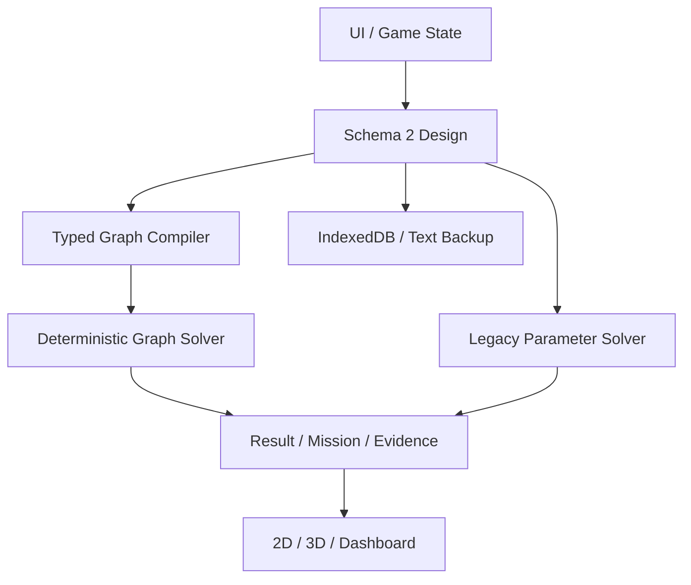

# Architecture — Optical Engine Tycoon v0.2.0

Release 0.2.0 / Schema 2 / Graph Model graph-compact-1.0.0 / Compiler graph-compiler-1.0.0 / Legacy analytical-link-1.0.0.

v0.1 pure numerical solver를 legacy-core.ts에 그대로 보존하고 Schema 2 wrapper, Graph Compiler, SVG Builder, 번들 Three.js를 추가한 Incremental Upgrade입니다. P0/P1 Parameter 계산·Mission02·저장·복원 위에 P2.0–P2.4를 구현했습니다.

| Source | 책임 |
|---|---|
| schema.ts | Design, Node, Typed Port, Channel Path, EditState, Result |
| legacy-core.ts / legacy-storage.ts | v0.1 numerical / compatibility baseline |
| graph.ts | Registry, compatible ports, path extraction, loss ledger, source allocation, dependencies |
| core.ts | Schema validation, migration, mode dispatch, KPI, Mission, fidelity/evidence |
| hash.ts | synchronous deterministic UTF-8 SHA-256 |
| storage.ts | envelope, Schema0/1→2, multipart, IDB head/LKG/revisions, stale-tab guard |
| builder.ts | Library, SVG, Inspector, selection, connections, trace |
| scene.ts | Three.js, OrbitControls, raycast, placement, WebGL fallback |
| app.ts | UI transaction, revisions/Undo/Redo, Solver, autosave, report |

Rendering을 Physics에서 import하지 않습니다. Design 수정 → validation → full deterministic solve → Mission/KPI → SVG/3D로 갱신합니다. Dependency list는 각 Parameter와 실제 영향을 받는 Channel을 표시합니다. P2는 안전한 full re-solve이며 partial cache는 구현하지 않았습니다.

Tx/Rx Optical Chain을 분리합니다. Tx ReceiverBoundary는 원격 Detector 기준면이며 Local Rx PD와 다릅니다. Tx Host→Driver→Modulator drive, Local PD→TIA→Rx Host도 필수입니다. ASIC 내부는 미설계입니다.

Port는 kind/signal/direction/flow가 호환되어야 합니다. Output fanout은 Splitter 독립 Port로 표현합니다. Missing/duplicate/cycle/wrong-type/unreachable/ambiguous-source/duplicate-channel을 진단합니다. 편집 중 Invalid Graph는 저장할 수 있으나 Mission FAIL, aggregate Unknown, score0입니다.

Graph는 compact Channel Bundle 모델입니다. FAU가 Fiber Count/WDM Count/Lane Rate/First Fiber ID/Stride를 할당하여 개별 경로를 펼칩니다. MUX/DEMUX는 지정 dB stage이며 spectral response를 계산하지 않습니다. Loss stage는 Node ID로 한 번만 합산하고 양쪽 실제 Port plane을 Report에 남깁니다. Splitter는 10log10(N)+excess loss, 총 transmission≤1, branch 간 공유 Source Group 중복 전력 방지를 적용합니다.

논리 Schematic와 mm Physical Placement는 분리됩니다. Cosmetic move/rotate/size는 KPI 불변입니다. Physical Routing의 enabled WG만 Start/End Node 중심과 waypoint의 polyline 길이를 mm→cm로 변환하여 alpha(dB/cm)×length(cm)를 계산합니다. 수동 Length를 덮어쓰지 않습니다. Coupler gap/offset/proximity는 coupling loss를 자동 보정하지 않습니다.

새 DB OpticalEngineTycoon-v02를 쓰고 이전 DB를 readonly import하여 원본 Head/LKG/Archive를 유지합니다. Migration은 Legacy Mode에서 원래 결과를 보존하고 migration.original과 state.schema1-original에 원본을 남깁니다. Native Head/LKG/Archive는 atomic transaction/SHA-256/stale-head guard로 보호합니다. Future Schema는 read-only입니다. 파일 위치/Profile/Browser가 달라질 때 Paste Restore가 portable recovery 경로입니다.

AI/API numerical solver는 사용하지 않습니다. Seed는 추적용이며 아직 Monte Carlo를 실행하지 않습니다. 기본 Physics 값은 Assumption, Model은 Analytical / Simplified, Uncalibrated입니다. Measurement Verified로 승격하는 경로는 없습니다.
